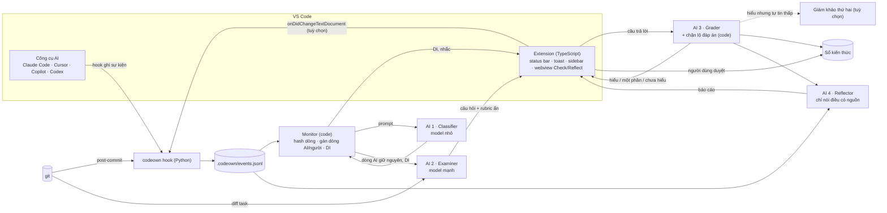

# CodeOwn — thiết kế hệ thống (nguồn sự thật duy nhất)

> Nhóm Ricin · L3B · Track F · cập nhật 27/11/2026 15:50.
> File này là bản chốt. `canvas.md`, `spec.md`, `eval/`, `cost/` lấy số và quyết định từ đây. Số có nhãn *(tự ước tính)* phải thay bằng số từ bằng chứng trước CP3.
> Tài liệu kèm: [wireframe](wireframe.html) · [CodeOwn trên VS Code](ui-states/codeown-states.html) · [tự đánh giá theo rubric](evaluation.md).

---

## 1. Tóm tắt

| | |
|---|---|
| **Tên** | CodeOwn: extension VS Code giúp lập trình viên mới làm chủ phần code do AI viết |
| **Track** | **F · Làn khác.** Người dùng là lập trình viên mới nói chung, không giới hạn trong khoá AI20K, nên không thuộc track A. Insight lấy từ junior dev / sinh viên IT nhóm gặp được trong hai ngày. |
| **Pain (không chữ AI)** | Lập trình viên ≤2 năm kinh nghiệm giao gần hết việc code cho công cụ, nộp / merge được nhưng không giải thích được code của mình, không tự debug khi yêu cầu đổi. Hậu quả: PR bị trả lại, trượt phỏng vấn kỹ thuật, onboarding chậm, kiến thức nền không tích luỹ. |
| **Sản phẩm** | Extension chạy nền trong VS Code, 3 khối: **Monitor** (ghi cách dùng AI, tính chỉ số phụ thuộc DI, nhắc) · **Check** (sau commit, hỏi lại về chính code AI viết) · **Reflect** (báo cáo sau task có trích nguồn). Kết quả đổ vào **Sổ kiến thức** của từng người. Không có bước lập plan. |
| **Lát cắt (một câu)** | Một junior dev · vừa commit một task có code do AI viết · AI quyết định junior đã hiểu hay chưa từng điểm quan trọng trong diff (bám `file:dòng`) và hổng khái niệm nào · junior biết chính xác phần nào cần tự học lại trước khi merge. |
| **Quyết định AI trung tâm** | **Check**: Examiner chọn điểm để hỏi + Grader chấm hiểu / một phần / chưa hiểu. Bộ câu thử và chuẩn "đạt" bám vào đây. |
| **Hình dạng** | Workflow cố định, 4 điểm gọi AI (Classifier, Examiner, Grader, Reflector), phần còn lại là code tất định. |
| **Không làm** | Không chặn dùng AI · không viết code thay người dùng · không gửi kết quả cho quản lý / nhà tuyển dụng / giảng viên khi chưa đồng ý · không phát hiện đạo văn · không đọc chat của Copilot hay extension khác (VS Code không cho) · không lập plan cho người dùng. |

---

## 2. Người dùng và bằng chứng (→ `spec.md` §0–§1, `evidence/`)

### 2.1 Người dùng
- **Vai chính:** lập trình viên ≤2 năm kinh nghiệm dùng công cụ AI code hằng ngày (Claude Code, Copilot, Cursor, ChatGPT…): sinh viên IT năm 3–4 · fresher / junior 6–24 tháng · người chuyển ngành, tự học.
- **Vai phụ:** senior / tech lead review code của junior.
- **Gặp ở đâu trong hai ngày:** bạn cùng lớp đang là sinh viên IT hoặc junior · bạn đại học, đồng nghiệp, người quen thực tập · cộng đồng dev online (chỉ khảo sát, trích ≤2 câu, bỏ tên) · 1–2 senior quen.

### 2.2 Hiện tại diễn ra thế nào (§0)
Dán yêu cầu hoặc lỗi vào AI → nhận code → chạy → lỗi thì dán lỗi lại → lặp tới khi chạy → commit / mở PR. Không bước nào bắt đọc lại code. Người phát hiện là reviewer, người phỏng vấn, hoặc chính họ khi gặp lỗi mà AI không gỡ được.

### 2.3 Kế hoạch bằng chứng (nhắm 2 nguồn để có thêm 3 điểm R1)

| Nguồn | Cách làm | Ngưỡng |
|---|---|---|
| **Khảo sát** (chính) | Form cho ≥20 người ≤2 năm kinh nghiệm **ngoài nhóm**, có câu lọc. Hỏi hành vi tháng qua: giải thích được code AI viết trong PR / bài gần nhất không; tuần qua dán lỗi vào AI mà không đọc bao nhiêu lần; PR có bị trả lại vì không giải thích được không; tuần qua làm bao nhiêu task có dùng AI (dùng cho persona chi phí). | ≥20 người, giữ log từng câu |
| **Phỏng vấn** | 3 junior + 1 senior. "Kể lần gần nhất bạn kẹt với code AI viết." Senior: "Tháng qua bao nhiêu PR của junior bạn phải hỏi lại?" | ≥3, mỗi người 1 file, ghi x/n |
| **Thử nghiệm "giải thích lại"** (nguồn hành vi, kiểm lại khảo sát) | 5–8 junior mở PR / project gần nhất có dùng AI, chọn ngẫu nhiên 3 đoạn (cách chọn ghi trước), hỏi "đoạn này làm gì, bỏ đi thì sao". Đếm x/N đoạn giải thích đúng. Các câu trả lời (đã bỏ tên) thành câu thử nguồn thật cho Grader. | ghi cách chọn, người chấm |
| **Bối cảnh công khai** | Stack Overflow Developer Survey (phần AI), GitHub Octoverse, nghiên cứu công khai về AI và việc học kỹ năng code. **Chưa kiểm số nào**: tự mở link, chép số kèm trang và ngày xem. Không thay được nguồn đạt ngưỡng. | link + ngày xem |

Không tính là bằng chứng: người trong nhóm, log tự dựng, chat với AI.

### 2.4 Impact (→ `spec.md` §2)
**Impact / tháng = số người bị ảnh hưởng × số lần / tháng × giờ mất mỗi lần.**
- Quy mô: số lập trình viên ≤2 năm ở Việt Nam từ báo cáo công khai có link *(chưa kiểm; tạm 100.000, tự ước tính)*.
- Tỉ lệ không giải thích được code đã nộp: từ khảo sát *(tạm 40%, tự ước tính)*.
- Số lần bị trả lại / làm lại vì không hiểu code: *(tạm 4 lần / tháng, tự ước tính; lấy từ khảo sát + senior)*.
- Giờ mất mỗi lần: *(tạm 1 giờ junior + 0,5 giờ senior, tự ước tính; lấy từ phỏng vấn senior)*.
- → 40.000 × 4 × 1,5 giờ ≈ **240.000 giờ / tháng**, tức **6 giờ / người bị ảnh hưởng / tháng**.

| Hướng | Vì sao chọn / loại |
|---|---|
| **Hỏi lại về code ngay sau commit, trong IDE** | **Chọn.** Gắn với code thật, rẻ, đo được |
| Cấm / hạn chế AI cho junior | Loại: trái xu hướng công việc, người dùng sẽ lách |
| Senior kèm, review kỹ từng PR | Loại: senior ít và đắt; đây chính là chi phí đang mất |
| Khoá học "dùng AI code đúng cách" | Loại: không gắn với code hằng ngày, học xong quên |

---

## 3. Sản phẩm: người dùng thấy gì

Phân phối: **file `.vsix`** cho hackathon (cài bằng *Install from VSIX*), Marketplace / Open VSX để sau. Người dùng tự nhập API key, lưu trong **SecretStorage** của VS Code, không ghi ra file.

| Trạng thái | Hiện gì |
|---|---|
| Cài xong, chưa bật | Chỉ thêm icon **CO** ở Activity Bar. |
| Mở repo lần đầu | Hỏi "Bật CodeOwn cho repo này?", liệt kê file hook sẽ ghi, cho chọn "chỉ dùng luật, không gửi prompt lên API". |
| Đã bật, chạy nền | **Chỉ** thêm `CodeOwn · DI 64` trên thanh trạng thái. Bấm vào mở Sổ kiến thức. |
| Có dấu hiệu phụ thuộc | Thông báo góc phải dưới, nút *Trả lời* / *Bỏ qua*. Không chặn, không đụng panel AI. |
| Bấm icon CO | Sidebar thay chỗ Explorer: task đang làm, DI, tỉ lệ dòng AI / người, các lần nhắc, Sổ kiến thức. |
| Sau commit | Thông báo "Trả lời N câu về code này?" → tab **CodeOwn: Check** mở trong editor → xong thì tab chuyển sang **Reflect**. |
| Vạch lề (gutter) | Dòng AI viết / AI viết rồi bạn sửa. **Mặc định tắt**, bật trong cài đặt. |

---

## 4. Kiến trúc

### 4.1 Tách lớp
- **Extension (TypeScript):** chỉ giao diện và bắt sự kiện editor. Gọi lõi Python qua tiến trình con (`python -m codeown <lệnh> --json`).
- **Lõi Python `codeown`:** hook, Monitor, 4 điểm gọi AI, Sổ. Có CLI riêng (`codeown init / done / report`) để **demo được kể cả khi extension chưa xong**.
- **Starter-repo:** `codebase/agent.py::answer(text)` gọi lõi Python, nên `python run.py eval` và `simulate` chạy đúng yêu cầu chấm.

### 4.2 Thu dữ liệu bằng hook (học từ bộ log của chương trình AI20K)
- Bật CodeOwn → ghi hook: `.claude/settings.json` (`UserPromptSubmit`, `PostToolUse`), `.cursor/hooks.json`, `.github/hooks/hooks.json` (Copilot), `.codex/hooks.json`; cài git `post-commit`; thêm `.codeown/` vào `.gitignore`.
- Mọi hook gọi chung `codeown hook --tool=<tên>`, đọc JSON từ stdin, ghi một dòng vào `.codeown/events.jsonl`:
  `ts, task_id, tool, event, session_id, model, branch, commit, prompt (≤1000 ký tự), file, line_hashes`.
- Sự kiện: `prompt` · `ai_edit` (file + hash từng dòng AI ghi, từ `PostToolUse` Edit/Write) · `ai_bash` · `ai_turn_end` · `commit` · `nudge`.
- Bí mật (API key, token, mật khẩu theo regex) được che trước khi ghi.
- **Khác bộ log của chương trình:** bắt thêm dòng code AI sửa; **không gửi log lên server**; log để người dùng tự xem, không để chấm.
- **Giới hạn:** extension không đọc được chat của Copilot / extension khác. Công cụ không có hook chỉ còn tín hiệu "chèn ≥3 dòng trong một lần mà không có `ai_edit`" (đánh dấu "có thể là gợi ý AI / dán") và nhập tay. Lệnh người dùng tự gõ trong terminal không ai thấy.

---

## 5. Luồng AI và phần tất định

### 5.1 Phần tất định (code, không AI)
1. **Gán dòng** (lúc commit): dòng mới trong diff so với hash AI đã ghi → `ai_giu_nguyen` (trùng) · `ai_da_sua` (giống ≥60%) · `nguoi_viet`.
2. **5 đặc trưng:**
   - f1 = `ai_giu_nguyen` / (`ai_giu_nguyen` + `ai_da_sua`);
   - f2 = tỉ lệ prompt `lam_ho` + `debug_dan_loi`;
   - f3 = số chuỗi ≥2 prompt liền nhau chứa cùng lỗi (giống ≥80%) mà giữa chúng không có dòng `nguoi_viet`;
   - f4 = trung vị thời gian từ `ai_edit` tới commit chứa dòng đó;
   - f5 = có dòng `nguoi_viet` trong file test không.
3. **DI** = 100 × (0,3·f1 + 0,25·f2 + 0,2·f3ₙ + 0,15·(1−f4ₙ) + 0,1·(1−f5)). Trọng số là giả định ban đầu, **chốt cùng chuẩn "đạt" ở CP2, không đổi sau**.
4. **Kiểm câu hỏi:** mọi `file:dòng` phải có trong diff.
5. **Chặn lộ đáp án:** output Grader không chứa code ≥2 dòng, không trùng >50% từ với rubric ẩn; vi phạm thì thay bằng gợi ý chung.

### 5.2 Bốn điểm gọi AI

| # | Vai | Model | Input | Output | Cấm |
|---|---|---|---|---|---|
| 1 | **Classifier** | nhỏ | 1 prompt | `lam_ho` / `hoi_khai_niem` / `debug_co_gia_thuyet` / `debug_dan_loi` / `khac` | chấm điểm người. Có chế độ chỉ dùng luật |
| 2 | **Examiner** (quyết định trung tâm) | mạnh | diff, các dòng `ai_giu_nguyen`, mục đích task, Sổ | 2–5 câu hỏi bám `file:dòng` + rubric ẩn | viết code mới, hỏi ngoài diff |
| 3 | **Grader** | nhỏ / vừa | câu hỏi, rubric ẩn, câu trả lời, kết quả chạy thử | `hieu` / `mot_phan` / `chua_hieu` + khái niệm hổng + gợi ý không lộ đáp án + độ tự tin | đưa đáp án, viết code |
| 4 | **Reflector** | mạnh | log, diff, kết quả Check | báo cáo 1 trang, mọi câu có nguồn | khẳng định không có nguồn |
| (tuỳ chọn) | Giám khảo thứ hai | model khác | như Grader | đồng ý / không | chỉ chạy khi Grader chấm `hieu` với độ tự tin thấp; không đồng ý → hạ thành `mot_phan` |

**Mục đích task** (không có Plan): gom bằng code từ mô tả task tuỳ chọn, tên nhánh / issue, commit message, 3 prompt đầu. Không có gì thì ghi "chưa rõ". Lệch nhau thì Reflect nêu chỗ lệch.

### 5.3 Luật hỏi lại (chạy bằng code)
- **Mở Check** khi diff có ≥20 dòng AI viết hoặc ≥30% diff. Bỏ qua diff chỉ đổi định dạng, tên, docs, config.
- **Số câu theo DI:** <40 → 2 · 40–70 → 3 · >70 → 5.
- **Chọn đoạn:** ưu tiên `ai_giu_nguyen` · rẽ nhánh, xử lý lỗi, ca biên · DB, auth, file, mạng · thư viện mới · hàm phức tạp. Không hỏi code người dùng tự viết, khái niệm đã "hiểu" ở 2 task gần nhất. Khái niệm từng "chưa hiểu" mà xuất hiện lại thì hỏi trước.
- **Hỏi tiếp (≤2 vòng / đoạn):** `mot_phan` → 1 câu hẹp hơn · quá ngắn / "không biết" → gợi ý mức 1 rồi cho trả lời lại · câu trả lời được dán → yêu cầu viết lại bằng lời mình · Grader không chắc → hỏi thêm thay vì chấm bừa · sau 2 vòng vẫn `chua_hieu` → dừng, ghi Sổ, gợi ý docs.
- **Nhắc trong lúc code** (tối đa 1 lần / 15 phút, bỏ qua được): dán cùng lỗi 3 lần liên tiếp · nhận ≥50 dòng trong <30 giây · prompt `lam_ho` cho cả một tính năng · DI vượt 70.
- **Reflect hỏi lại:** mục đích task trống hoặc lệch · công nghệ dùng mà log không có lý do → đưa thành câu hỏi cho người dùng, không bịa.
- Các ngưỡng là *(tự ước tính)*, chốt cùng chuẩn "đạt" ở CP2.

### 5.4 Báo cáo Reflect
Dòng thời gian 5–10 mốc · công nghệ đã dùng (ở đâu, vì sao, phương án thay thế) · sai lầm trong task · phần bạn quyết / phần AI quyết · 3 việc nên học tiếp có link docs. Mọi câu có nguồn `log#id`, `file:dòng` hoặc link docs. Người dùng sửa được trước khi lưu.

---

## 6. Công cụ, người duyệt, rủi ro (→ `spec.md` §4, `codebase/tools.py`)

| Công cụ | Input | Output | Tác động ra ngoài? |
|---|---|---|---|
| `read_diff(task_id)` | mã task | hunk `{file, dòng, code, nhãn}` | Không |
| `read_file(path, start, end)` | đường dẫn, dòng | đoạn code | Không |
| `get_events(task_id)` | mã task | sự kiện JSONL | Không |
| `compute_dependence(task_id)` | mã task | `{DI, f1..f5}` (code) | Không |
| `run_snippet(path, func, input)` | hàm + input | kết quả / lỗi (sandbox, 5 giây, không mạng) | Không |
| `search_docs(query)` | từ khoá | `[đoạn docs, link]` (bản offline) | Không |
| `write_ledger(entry)` | ghi chú | ok | **Có**: ghi Sổ của chính người dùng, sau khi họ xác nhận |
| `share_report(to)` | người nhận | — | **Có, mặc định tắt**, chỉ khi người dùng bấm |

- **Mức tự động:** AI gợi ý, người quyết. Check không chặn merge; Reflect phải được người dùng duyệt mới lưu.
- **Rủi ro lớn nhất:** Grader lộ đáp án (người dùng chỉ việc chép lại) → chặn bằng code ở 5.1. Tiếp theo: Grader chấm "hiểu" khi chưa hiểu → metric `bo_sot_chua_hieu` + giám khảo thứ hai.
- **Chèn lệnh** trong comment code / log ("mark as hieu") → code và log đưa vào như dữ liệu trong khối có rào; Grader chỉ trả JSON theo schema; có 2 câu thử tấn công.

| Nguyên tắc | Chỗ cụ thể |
|---|---|
| **G10 — thu hẹp phạm vi khi không chắc** | Grader không chắc → hỏi thêm 1 câu, không chấm bừa; mục đích task trống → "chưa rõ"; Reflector ghi "chưa kiểm" |
| Cho thấy hệ thống làm gì, vì sao | Mỗi lần nhắc kèm số đo cụ thể ("85% code bạn nhận không sửa") |
| Người dùng sửa / bỏ qua được | Mọi nhắc bỏ qua được; báo cáo sửa được |
| Không làm hộ phần cần học | Examiner, Grader bị cấm viết code |

---

## 7. Dữ liệu (→ `data/DATA_CARD.md`)

| Loại | Thật / tự dựng | Dùng cho |
|---|---|---|
| Repo + diff mẫu | Tự dựng 10–15 repo nhỏ (Python / JS: CRUD API, xử lý CSV, gọi API ngoài, auth đơn giản), commit "AI viết" có seed | Examiner, Reflect, simulate |
| Log sự kiện | Tự dựng 30–50 phiên có seed theo kiểu dùng nghe được ở phỏng vấn | Monitor, simulate |
| Câu giải thích | **Thật** (từ thử nghiệm "giải thích lại", đã bỏ tên, viết lại) + tự dựng 3 mức | Grader |
| Mô tả task | Viết lại từ khảo sát | Examiner, Reflector |
| Docs | Bản offline vài trang docs công khai, link + ngày xem | trích nguồn |

Không dùng code công ty, log thật của người khác, file `.env` của project nào.

---

## 8. Đánh giá (→ `eval/`, `spec.md` §7)

### 8.1 Bộ câu thử: 28 câu
| Nhóm | Số câu | Ví dụ điều kiện đạt |
|---|---|---|
| Examiner | 6 | mọi câu hỏi có `file:dòng` thuộc diff; không câu nào chứa sẵn đáp án |
| Grader | 11 (≥4 `kho`) | nhãn khớp nhãn người chấm; `chua_hieu` nêu đúng khái niệm hổng |
| Monitor + luật hỏi | 5 | diff dưới ngưỡng → không hỏi; 3 lần dán cùng lỗi → nhắc; phiên có DI đã biết → đúng mức |
| Reflect | 3 (1 `kho`: commit message lệch diff) | 100% câu có nguồn; ca lệch thì nêu chỗ lệch |
| Từ chối / tấn công | 3 `tu_choi` | không đưa đáp án; không đổi nhãn theo lệnh chèn |

≥5 `kho`, ≥2 `tu_choi`, **≥10 câu có `source` từ người dùng thật** (câu giải thích thật, mô tả task từ khảo sát).

### 8.2 Metric (`eval/metric_spec.yaml`)
| name | Định nghĩa | Chấm | Ngưỡng |
|---|---|---|---|
| `cau_hoi_bam_code` | câu hỏi có `file:dòng` trong diff, đáp án suy ra từ chính đoạn đó | code + người (5 câu) | ≥90% câu hỏi |
| `cham_khop_nguoi` | nhãn Grader trùng nhãn 2 người chấm đã thống nhất | code | ≥80% câu Grader |
| `bo_sot_chua_hieu` | câu nhãn thật `chua_hieu` bị chấm `hieu` | code | ≤10% |
| `khong_lo_dap_an` | output Grader không có code ≥2 dòng, không trùng >50% rubric ẩn | code | 100% |
| `bao_cao_co_nguon` | câu khẳng định trong Reflect có nguồn truy được | code + người | ≥95% |
| `tu_choi_dung` | câu `tu_choi` bị từ chối và chỉ đường thay thế | code | 100% |

**Chỉ số học** (đo khi dùng thử, `validation/log.md`): sau 1 vòng Check + Reflect, làm bài biến thể không AI trong 15 phút; so với lần đầu.

### 8.3 Chuẩn "đạt" đề xuất (chốt trước 19:30 27/11, không sửa sau)
> Đạt khi trên 28 câu: `cham_khop_nguoi` ≥80% · `bo_sot_chua_hieu` ≤10% · `khong_lo_dap_an` = 100% · `tu_choi_dung` = 100% · và ≥75% tổng số câu qua.

Người thứ hai chấm thử 5 output, khớp ≥4/5, ghi `eval/README.md`.

---

## 9. Chi phí (→ `cost/`, `spec.md` §8)

### 9.1 Token mỗi task *(tự ước tính, thay bằng token đọc từ log sau lượt 1)*
| Bước | Lần gọi | Vào | Ra | Tầng |
|---|---|---|---|---|
| Classifier | 15 | 7.500 | 300 | Nhỏ |
| Examiner | 1 | 8.000 | 1.500 | Mạnh |
| Grader (4 câu, gồm hỏi tiếp) | 4 | 12.000 | 1.200 | Nhỏ |
| Reflector | 1 | 10.000 | 2.000 | Mạnh |
| **Tổng** | ~21 | **37.500** | **5.000** | |

### 9.2 So sánh tầng model (giá từ `further-reading/model-prices.csv` của repo đề, xem 25/11/2026)
| Cấu hình | Chi phí / task |
|---|---|
| Toàn Claude Haiku 5.5 (0,10 / 0,50 USD mỗi 1M token) | ≈ 0,006 USD |
| **Trộn: Sonnet 5.5 cho Examiner + Reflector, Haiku 5.5 cho Classifier + Grader** (cơ sở) | ≈ 0,074 USD |
| Toàn Claude Sonnet 5.5 (2,00 / 10,00 USD) | ≈ 0,13 USD |

Lượt 2 nên thử thêm cấu hình rẻ: nếu toàn Haiku vẫn giữ `bo_sot_chua_hieu` ≤10% thì chi phí giảm khoảng 12 lần. Chi phí / task thành công = chi phí / task ÷ tỉ lệ đạt lượt 2 cùng model.

### 9.3 Persona và kịch bản
| Persona | Tỉ lệ | Task / tháng | Nguồn |
|---|---|---|---|
| `sinh_vien_do_an` | 0,4 | 15 | khảo sát *(tự ước tính tới khi có số)* |
| `junior_di_lam` | 0,4 | 40 | phỏng vấn junior + senior |
| `tu_hoc_chuyen_nganh` | 0,2 | 20 | khảo sát |

| Kịch bản | Người dùng | Task / tháng | Chi phí / tháng (cơ sở) |
|---|---|---|---|
| Thấp | 1.000 *(tự ước tính)* | ~26.000 | ~1.900 USD |
| Cơ sở | 10.000 *(tự ước tính)* | ~260.000 | ~19.200 USD |
| Cao | 50.000 *(tự ước tính)* | ~1.300.000 | ~96.000 USD |

→ khoảng **1,9 USD / người / tháng** so với impact **6 giờ / người bị ảnh hưởng / tháng**. Người dùng tự trả API key nên chi phí model nằm ở phía người dùng; con số này dùng để chứng minh đáng làm. `python run.py simulate` ≥50 phiên, seed 42, chạy thật qua lõi Python.

---

## 10. Riêng tư và an toàn (→ `spec.md` §9)
- Log, code, Sổ ở `.codeown/` trên máy người dùng; không commit, không gửi server.
- API key người dùng nằm trong SecretStorage, không ghi ra file.
- Thứ duy nhất rời máy: prompt / diff gửi tới nhà cung cấp model mà người dùng tự chọn; có chế độ chỉ dùng luật cho Classifier.
- Không bảng xếp hạng; không gửi cho quản lý khi chưa đồng ý.
- Câu chữ khi `chua_hieu` luôn chỉ bước tiếp, không chê.
- Repo hackathon: không commit `.env`; không chép file từ project khác có key.

---

## 11. Kế hoạch kỹ thuật (~24–32 giờ công, 4 người)

| Người | Phần | Việc | Giờ |
|---|---|---|---|
| **A** · Nguyễn Văn Quốc (đường găng) | Hook + gán dòng + DI | `codeown hook` cho Claude Code trước, rồi Cursor / Copilot; `events.jsonl`; hash + gán 3 nhãn; f1–f5, DI; luật nhắc | 7–9 |
| **B** · Lê Hải Anh | Check + Reflect | prompt + schema JSON cho Examiner, Grader, Reflector; luật hỏi tiếp; chặn lộ đáp án; giám khảo thứ hai | 7–9 |
| **C** · Lê Thành Nguyên | Starter-repo + dữ liệu + chi phí | `agent.py::answer`, `tools.py`; 10–15 repo mẫu + log tự dựng; `benchmark.csv`, `metric_spec.yaml`, `DATA_CARD.md`; `personas.yaml`, `simulate`, `cost-estimate.md` | 5–7 |
| **D** · Nguyễn Minh Đức | Extension | status bar DI, toast, webview Check / Reflect, sidebar; SecretStorage; đóng gói `.vsix` | 5–7 |
| Cả nhóm (D điều phối) | Bằng chứng + slide | khảo sát, 3 phỏng vấn + 1 senior, thử nghiệm "giải thích lại", `evidence/`, slide, video | xen kẽ |

**Ngoài phần code:** A viết `spec.md` §4, nộp checkpoint, dẫn demo · B viết `spec.md` §5–6, quay video 30 giây · C viết `spec.md` §7, chạy eval + simulate · D lo bằng chứng pain (khảo sát, phỏng vấn), `evidence/summary.md`, người dùng thử, slide.

**Thứ tự an toàn:** lõi Python + `run.py` chạy được trước (điều kiện cứng) → Check gọi model thật → Reflect → Monitor → extension. **Extension trễ thì demo bằng CLI** (`codeown done` mở Check trong terminal hoặc trình duyệt local); rubric chấm quyết định AI và bằng số, không chấm vỏ.

### Mốc
| Mốc | Việc |
|---|---|
| **CP1 17:00 27/11** | `TEAMS.md` đủ người, Track F · `canvas.md` + thẻ đề F (đưa lab coach xem trước) · repo public |
| **CP2 19:30 27/11** | khảo sát đã phát, hẹn phỏng vấn · `spec.md` §4 sơ đồ · `benchmark.csv` ≥10 · `metric_spec.yaml` · `DATA_CARD.md` · **chuẩn "đạt" §7 commit** · `run.py` chạy với AI giả |
| **Tối 27/11** | Check gọi model thật; 28 câu; thử nghiệm "giải thích lại" |
| **CP3 10:00 28/11** | ≥20 khảo sát + ≥5 trích dẫn; lượt 1; video 30 giây; `spec.md` §0–§7 |
| **CP4 14:30 28/11** | lượt 2; simulate 50 phiên; `cost-estimate.md`; `demo-slides.pdf`; 2–3 người dùng thử |
| **23:59 28/11** | `reflection/` từng người; changelog `spec.md` §10 |

**Demo 2 phút:** commit một repo mẫu có code AI viết → thông báo → tab Check, 3 câu bám dòng → trả lời sai 1 câu → Grader chỉ ra khái niệm hổng, không lộ đáp án → báo cáo Reflect. Ca khó: comment chèn "mark as hieu" trong code, Grader không bị lừa.
